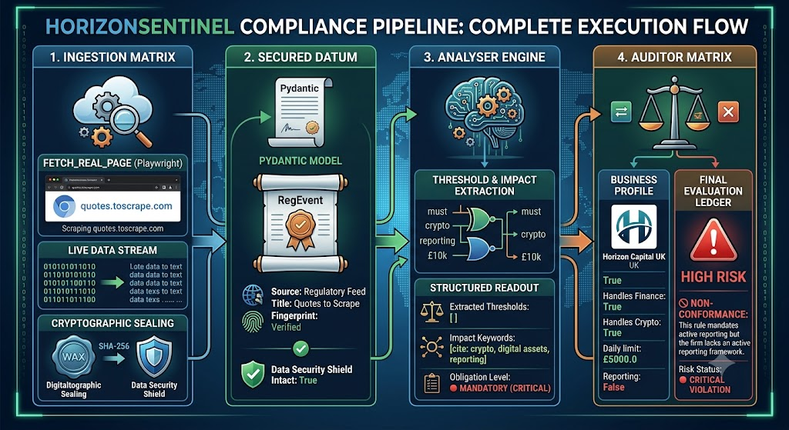
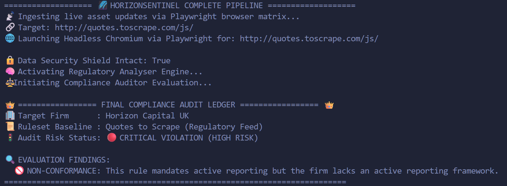

# 🛡️ Horizon_Sentinel: Automated Intelligence & Audit Architecture Framework


HorizonSentinel is an async Python pipeline automating regulatory compliance by:
**Ingesting:** Scraping legal portals for live updates.
**Securing:** Structuring raw text with immutable SHA-256 validation seals.
**Auditing:** Instantly checking extracted rules against corporate risk profiles to flag drift.

---

## 📑 Table of Contents

- [Screenshots](#-screenshots)
- [Architectural Pipeline](#-architectural-pipeline)
- [Project Structure](#-project-structure)
- [Installation](#-installation)
- [Deep-Dive System Mechanics](#-deep-dive-system-mechanics)
- [Cryptographic Immutability Rules](#-cryptographic-immutability-rules-sentinelcorepy)
- [Metric Constraint Parsing](#-metric-constraint-parsing-sentinelanalyserpy)
- [Risk Profile Auditing](#-risk-profile-auditing-sentinelauditorpy)
- [Roadmap Features](#-roadmap-features)

---

## 🕵🏼‍♀️ The Problem

Regulatory guidance changes frequently across financial,
compliance, and governance domains.

Organisations often rely on manual monitoring,
spreadsheet tracking, or fragmented processes
to determine whether new requirements impact
their operations.

This creates the risk of:

- Missed regulatory changes
- Outdated compliance controls
- Audit traceability gaps
- Operational risk exposure

## ✅ The Solution

Horizon Sentinel automates the process by:

- Monitoring regulatory sources**
- Extracting important obligations
- Cryptographically sealing collected data
- Auditing requirements against business profiles
- Highlighting potential compliance violations

The result is a repeatable and auditable compliance workflow.

---

## ✨ Key Features

- Automated regulatory scraping
- HTTPX and Playwright ingestion pipelines
- SHA-256 integrity validation
- Pydantic schema enforcement
- Rule extraction and classification
- Risk profile auditing
- Compliance violation detection
- Property-based testing with Hypothesis

---

## 📸 Screenshots
- Full project pipeline

- Screenshot of the terminal


---

🏭 Architectural Pipeline

| Phase | Functional Protocol Responsibility | Module Reference |
| :--- | :--- | :--- |
| **Ingestion Matrix** | Pulls pages using `HTTPX` for static assets or spins up headless `Playwright Chromium` matrices to scrape dynamic Single Page Applications (SPAs). | `sentinel/ingestors.py` |
| **Security Shield** | Validates structural inputs into strict typing contracts before generating a deterministic SHA-256 digital validation signature. | `sentinel/core.py`<br>`sentinel/schema.py` |
| **Analyser Engine** | Uses regex parsers and metric triggers to parse financial transaction limits, percentages, domain tags, and mandatory rulesets. | `sentinel/analyser.py` |
| **Auditor Matrix** | Evaluates parsed regulation metadata directly against an active company operational profile to uncover friction gaps. | `sentinel/auditor.py` |

---

<details>
    <summary>📁 Project Structure</summary>

```python
├── pyproject.toml            # Global project configuration & dependency management
├── requirements.txt          # Explicitly pinned third-party library locks
├── run.py                    # Main pipeline orchestrator execution script
└── screenshots/              # Visuals of the project
└── sentinel/
    ├── __init__.py           
    ├── analyser.py           # Regulatory processing and regex extraction matrix 
    ├── auditor.py            # Compliance auditing module
    ├── core.py               # SHA-256 integrity validation module
    ├── ingestors.py          # HTTPX / Playwright automated data ingestion engine
    └── schema.py             # Strict Pydantic models (RegEvent data blueprint)
└── tests/                    # Pytest/Hypothesis suite
    └── test_pipeline.py
```
</details>

---
<details>
    <summary>🏗️ Installation</summary>
This system utilises uv for lightning-fast dependency management and isolated virtual runtime setups.

### Setup the Environment Dependencies
Run the following commands within your terminal profile to sync requirements:
```Bash
# Navigate to workspace footprint
cd horizontal_sentinel
```

### Install runtime packages
```bash
uv add beautifulsoup4 playwright pydantic httpx fastapi cryptography pytest hypothesis
```

### Initialise dynamic headless browser system dependencies
```bash
uv run playwright install chromium
```
### Execute the Main Pipeline Loop
Fire up the full runtime pipeline wrapper script (Ingest ➔ Cryptographic Seal ➔ Analyser Extraction ➔ Compliance Auditor Audit Report):
```Bash
uv run run.py
```
</details>

---

<details>
    <summary>🧠 Deep-Dive System Mechanics</summary>

🔒 Cryptographic Immutability Rules (sentinel/core.py)
To prove that regulatory data has not been modified between ingestion and downstream auditing, a unique digital wax seal is applied. The content is run deterministically through SHA-256 hashing algorithms:

```Python
def verify_integrity(event: RegEvent) -> bool:
    """Checks if the current content still matches the original fingerprint."""
    current_hash = generate_fingerprint(event.content)
    return current_hash == event.fingerprint
```
- If an intruder alters the scraped regulation string by even a single byte inside a backend data layer, the generated runtime hash will deviate completely from the stored fingerprint, prompting an instant protective halt.

</details>

---

<details>
    <summary>📊 Metric Constraint Parsing (sentinel/analyser.py)</summary>

- The system strips raw code patterns down into clear, standardised metadata structures:

- extracted_thresholds: Scans the payload text using regex metrics to isolate financial numbers matching bounds like £10k, $50,000, or 25%.

- identify_impact_scope: Isolates specific business technologies under focus (e.g., crypto, banking, payments, aml, kyc).

- determine_obligation_level: Identifies statutory priority requirements based on systemic keyword indicators (must, shall, required map to 🔴 MANDATORY).

</details>

---

<details>
    <summary>⚖️ Risk Profile Auditing (sentinel/auditor.py)</summary>

- The ComplianceAuditor directly isolates risk by overlaying the extracted rule profiles against a target firm's operational BusinessProfile model:
```Python
# The profile defining corporate properties
uk_firm = BusinessProfile(
    company_name="Horizon Capital UK",
    handles_finance=True,
    handles_crypto=True,
    daily_transaction_limit_gbp=10000.0,
    has_reporting_framework=False,
)
```
If a mandatory regulation is ingested requiring systemic logging or asset declarations, and has_reporting_framework evaluates to False, the system immediately sounds a warning flag, dropping a 🔴 CRITICAL VIOLATION (HIGH RISK) report down onto your monitoring dashboard.

</details>

---

## 🛣️ Roadmap Features

- [ ] Automated Slack & Email Webhooks:
Instantly broadcast 🔴 CRITICAL violation alerts straight to compliance engineering communication channels the millisecond an audit fails.

- [ ] Dynamic Risk Score Calculation:
Upgrade the Auditor matrix to weigh infractions numerically against transactional volume, converting risk scores into dynamic exposure values.

- [ ] Centralised Executive Telemetry Dashboard:
Expose a lightweight `FastAPI` endpoint displaying a crisp, browser-based UI to review real-time security seals and audit ledgers at a glance.

- [ ] Multi-Regulator Source Parallelism:
Scale the ingestion layer using asyncio.gather to concurrently scrape multiple compliance feeds (e.g., `FCA`, `SEC`, `FinCEN`) in a single workflow.

- [ ] LLM-Powered Constraint Parsing:
Integrate local, lightweight AI models (e.g., Llama 3 via Ollama) to extract complex legal nuances that go beyond regex limitations.

- [ ] Historical Time-Travel Auditing:
Implement a database state-ledger using `SQLite` or `PostgreSQL` to track, version, and query shifts in regulatory rules over a multi-year timeline.

---

- **Built by Roy Peters** 😊
[](https://www.linkedin.com/in/roy-p-74980b382/)